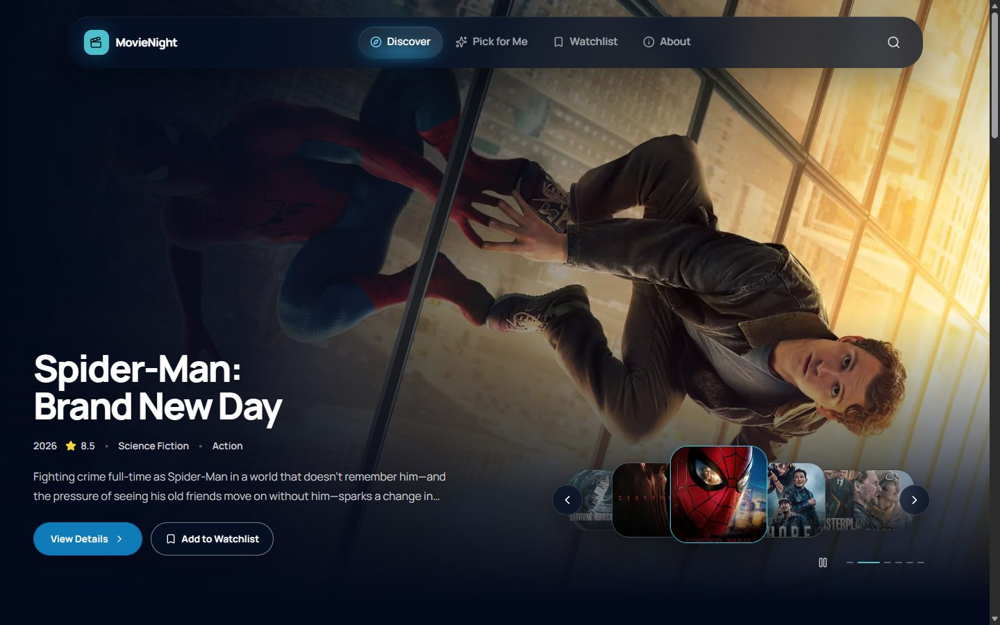
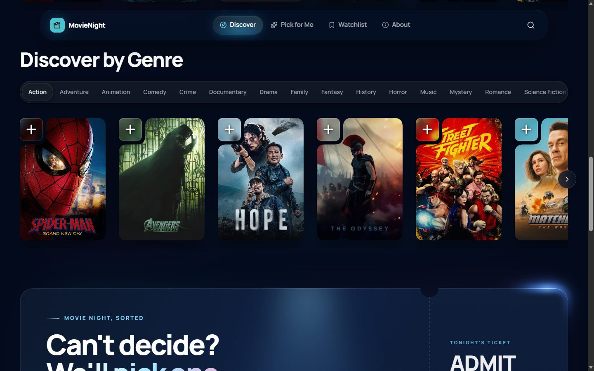
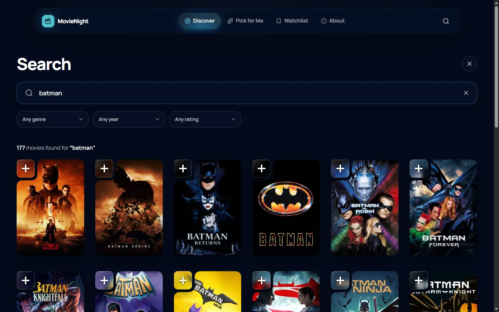
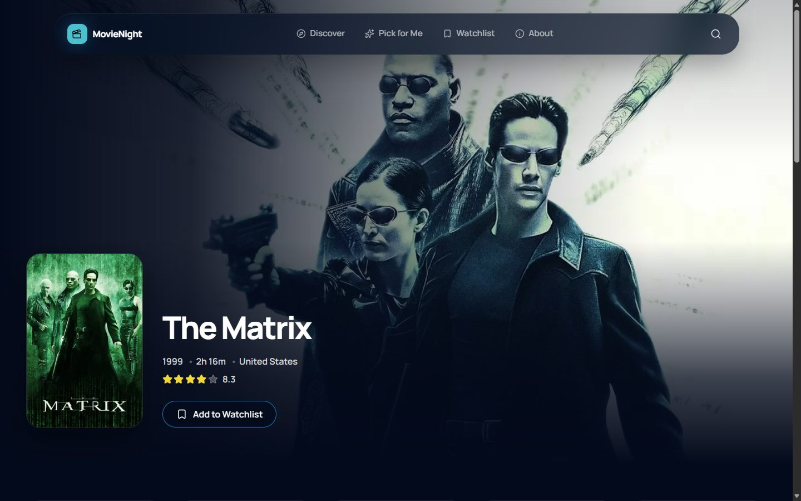
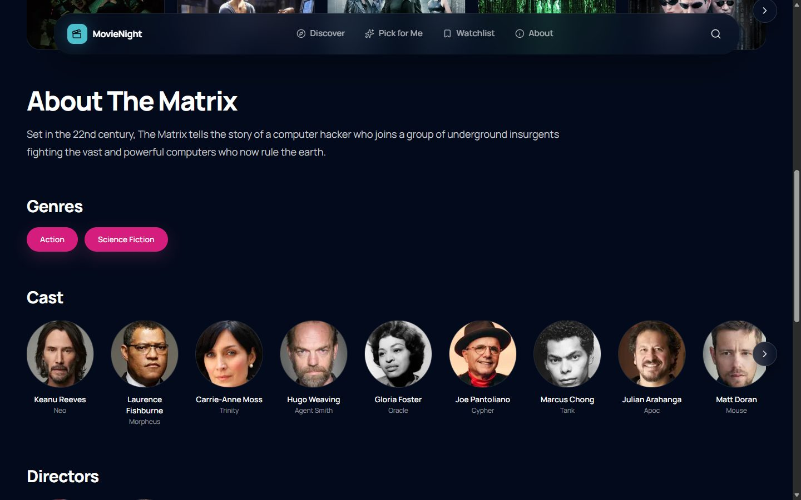
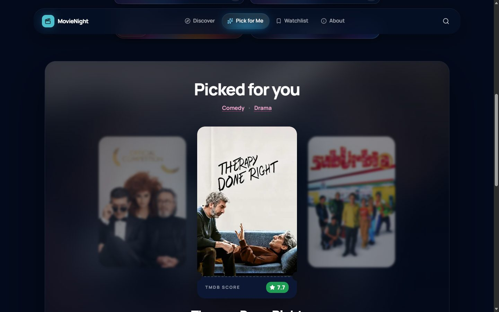
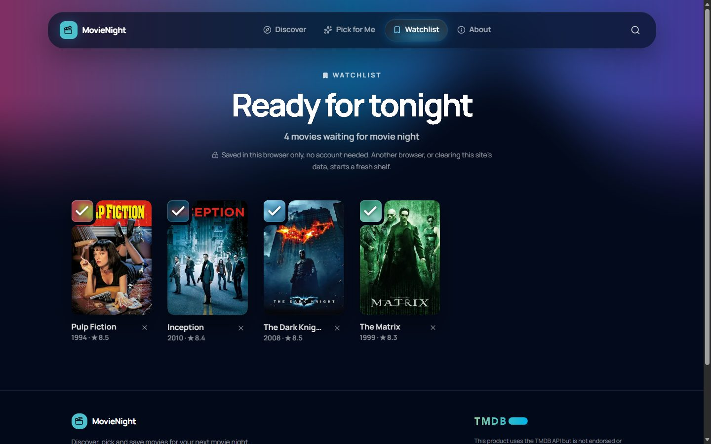
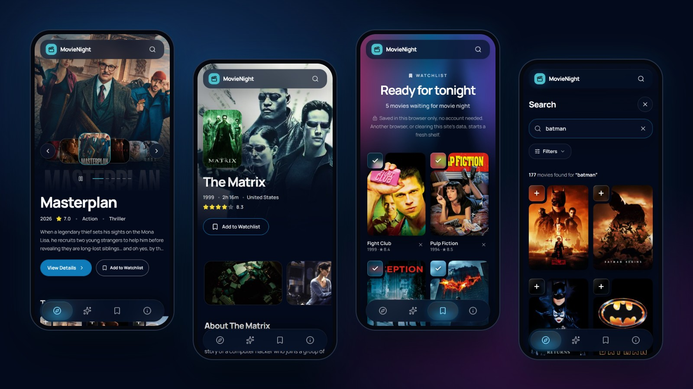

# MovieNight

Discover, search and pick movies for your next movie night, and keep a private watchlist without creating an account.



**MovieNight is open source and a good starting point for your own movie site.** It is a portfolio project: an **ASP.NET Core 10** API and a **Next.js 16** frontend over the [TMDB](https://www.themoviedb.org/) catalog, built almost entirely by an AI coding agent working in small, reviewed steps (see [docs/AI-WORKFLOW.md](docs/AI-WORKFLOW.md)).

## Features

- **Home:** featured hero carousel, trending and popular rails, instant genre discovery, curated collections (Marvel, Star Wars, Harry Potter and more) and an "Iconic: top rated of all time" rail.
- **Search and filters:** by title, release year, genre and minimum rating, with paging.
- **Movie details:** cast, directors, scene gallery with a full-size viewer, recommendations.
- **Pick for Me:** tell it your mood (genre, year, rating) and it picks one movie.
- **Anonymous watchlist:** up to 50 movies, stored per browser with a protected cookie; no sign-up, no tracking.
- **Quality:** responsive from 320 px, keyboard accessible and axe-clean, friendly loading / empty / error states, and a server-side cache tuned per kind of data.

### Desktop

<table>
  <tr>
    <td></td>
    <td></td>
  </tr>
  <tr>
    <td></td>
    <td></td>
  </tr>
  <tr>
    <td></td>
    <td></td>
  </tr>
</table>

### Mobile



## Use it as a template

The code is MIT-licensed, small and documented, so you can fork it as a base for a movie discovery site of your own. You get a working API with caching and tests, a polished responsive frontend, and an anonymous watchlist you can keep or remove. To make it yours:

- **Name, colors and content:** the brand colors are tokens in `frontend/src/app/globals.css`; the About page and its social links are in `frontend/src/components/about/about-experience.tsx`; page titles and the social-preview image are in `frontend/src/app/layout.tsx` and `opengraph-image.tsx`.
- **Collections:** the curated Home collections are one list in `backend/MovieNight.Api/Features/Collections/MovieCollectionCatalog.cs`.
- **Features:** keep what you need (for example, drop the watchlist and SQLite for a read-only catalog). Read [ARCHITECTURE.md](ARCHITECTURE.md) and [DECISIONS.md](DECISIONS.md) first; they explain the boundaries and why they exist.
- **Keep the TMDB attribution** in the footer and README, and use your own TMDB token: TMDB's terms apply to any site you publish.
- Working with an AI agent? [CLAUDE.md](CLAUDE.md) and [docs/AI-WORKFLOW.md](docs/AI-WORKFLOW.md) are ready to use.

## Tech stack

| | |
|---|---|
| Frontend | Next.js 16 (App Router), React 19, TypeScript, Tailwind CSS 4, Base UI, motion |
| Backend | .NET 10, ASP.NET Core controllers, EF Core + SQLite, `IMemoryCache`, Problem Details, OpenAPI + Scalar |
| Testing | xUnit (unit + in-memory HTTP tests), Vitest + Testing Library, axe-core and browser scripts |
| Data | TMDB API (the browser never calls it; the backend does) |

Architecture in short: `Browser → Next.js → ASP.NET Core API → TMDB`, with SQLite storing only watchlist rows. Details in [ARCHITECTURE.md](ARCHITECTURE.md), the reasons in [DECISIONS.md](DECISIONS.md).

## Run it locally

### 1. Prerequisites

- [.NET 10 SDK](https://dotnet.microsoft.com/download)
- [Node.js](https://nodejs.org/) 22 or newer (with npm)
- A free TMDB account and API Read Access Token (next section)

### 2. Get a TMDB API token

MovieNight needs your own TMDB token; none is included in this repository.

1. Create a free account at [themoviedb.org](https://www.themoviedb.org/signup) and verify your e-mail.
2. Open **Settings → API** ([themoviedb.org/settings/api](https://www.themoviedb.org/settings/api)), choose **Create → Developer**, accept the terms and fill in the short application form (personal / educational use is fine).
3. On the API page, copy the **API Read Access Token** (a long string starting with `eyJ`). This is the token MovieNight uses. You do not need the shorter "API Key".

### 3. Store the token safely

The token is a secret. Keep it out of Git: never put it in `appsettings.json`, `.env.example`, source code, a screenshot or an issue, and never in the frontend or a `NEXT_PUBLIC_` variable (those are sent to every visitor's browser).

**On your computer** (recommended: .NET user secrets, stored outside the repository):

```bash
cd backend/MovieNight.Api
dotnet user-secrets set "Tmdb:ReadAccessToken" "PASTE_YOUR_READ_ACCESS_TOKEN"
```

Or set an environment variable for the current terminal instead:

```bash
export Tmdb__ReadAccessToken="PASTE_YOUR_READ_ACCESS_TOKEN"        # macOS / Linux / Git Bash
$env:Tmdb__ReadAccessToken = "PASTE_YOUR_READ_ACCESS_TOKEN"        # Windows PowerShell
```

**On a host** (any provider): add a secret environment variable named `Tmdb__ReadAccessToken` (double underscore) in the provider's secrets / environment settings. Do not commit it and do not bake it into an image. Also see [Before deploying](#before-deploying).

If the token is missing or invalid, the API refuses to start (missing) or answers 502 on movie requests (invalid) without ever echoing the token. If you ever leak a token, revoke it on the TMDB API page and create a new one.

### 4. Start the backend

```bash
dotnet tool restore                                   # installs the EF Core CLI (once)
dotnet restore backend/MovieNight.slnx                # restores packages (once)
cd backend/MovieNight.Api
dotnet tool run dotnet-ef database update             # creates the SQLite database (once)
dotnet run --launch-profile http                      # http://localhost:5080
```

Check it: <http://localhost:5080/api/health> returns `{"status":"ok"}`. In Development the API reference is at <http://localhost:5080/scalar>.

### 5. Start the frontend

In a second terminal:

```bash
cd frontend
cp .env.example .env.local        # points the frontend at http://localhost:5080
npm ci
npm run dev                       # http://localhost:3000
```

Open <http://localhost:3000>.

## Tests and checks

```bash
dotnet test backend/MovieNight.slnx                                   # backend unit + HTTP tests
cd frontend && npm run typecheck && npx eslint && npm test            # types, lint, frontend tests
npm run build                                                         # production build
```

With both servers running, the browser scripts (Edge or Chrome required, live TMDB data) run the user journeys, a responsive sweep, an accessibility audit and page-load measurements. `npm run e2e:stubbed` runs fixture-based checks that need no TMDB token. See [frontend/e2e/README.md](frontend/e2e/README.md).

## Project structure

```text
backend/MovieNight.Api/        ASP.NET Core API (Controllers, Features, Integrations/Tmdb, Data)
backend/MovieNight.Api.Tests/  unit tests and Http/ tests (real app, fake TMDB)
frontend/src/                  app routes, components, lib/api (the only backend client), types
frontend/e2e/                  browser journey, sweep, accessibility and performance scripts
contracts/api-shapes.json      API shapes checked by both test suites
docs/                          roadmap, stage summaries, AI workflow, README images
CLAUDE.md                      instructions for AI coding agents
```

## Before deploying

MovieNight is built to run locally; deployment is out of scope for version 1. If you host it, also: set `Cors__AllowedOrigins__0` to the frontend's address, `NEXT_PUBLIC_API_BASE_URL` (at build time) to the API's address and `NEXT_PUBLIC_SITE_URL` to the public site address; serve both over HTTPS (the anonymous cookie is then `Secure`); and decide on the items deliberately left open in [D033](DECISIONS.md): Content-Security-Policy, rate limiting, HTTPS redirect and HSTS. The SQLite file lives in `backend/MovieNight.Api/App_Data/` and needs a persistent disk.

## Working with AI agents

[CLAUDE.md](CLAUDE.md) holds the rules agents follow in this repository, and [docs/AI-WORKFLOW.md](docs/AI-WORKFLOW.md) explains how to maintain and extend the project with an agent.

## Credits and license

This product uses the TMDB API but is not endorsed or certified by TMDB. Movie data and images are provided by [TMDB](https://www.themoviedb.org/).

Released under the [MIT License](LICENSE): free to use, copy, modify and publish, including as a template for your own project. Stars, forks and feedback are welcome.
